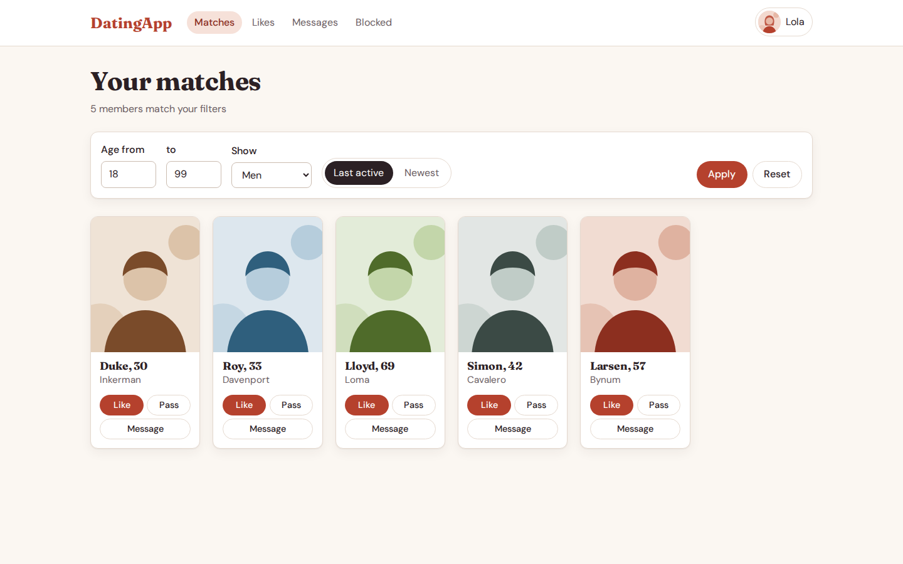
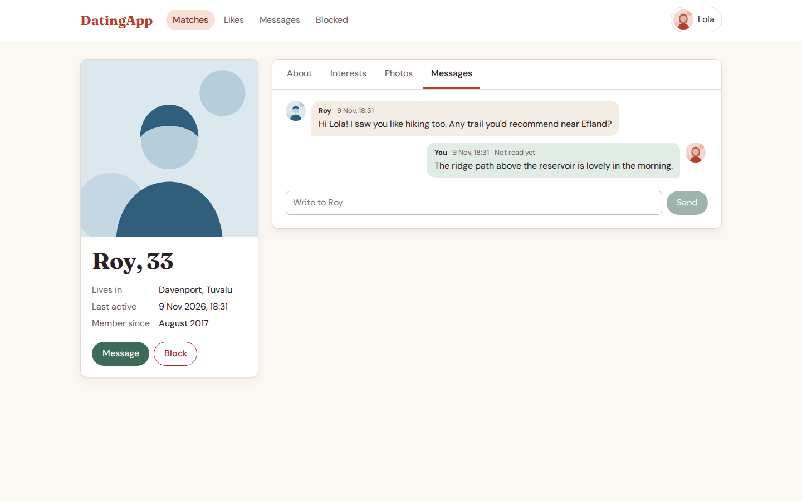
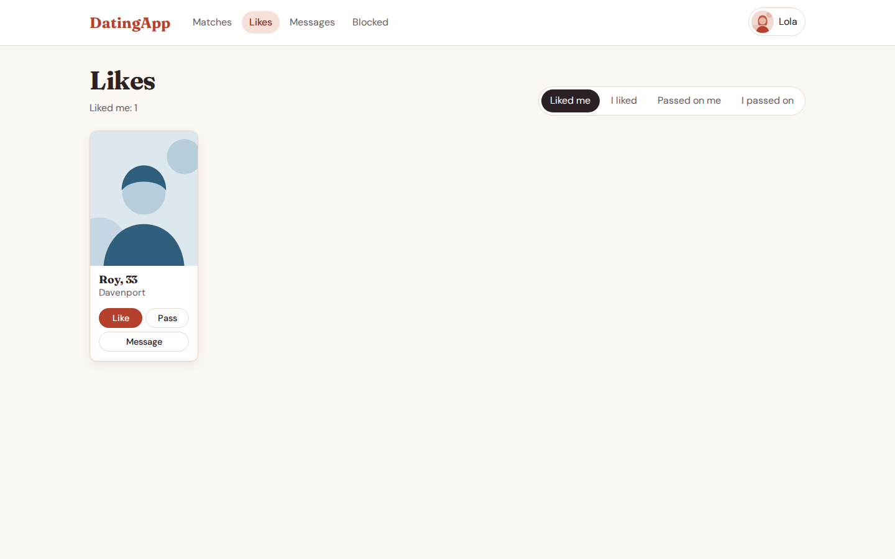
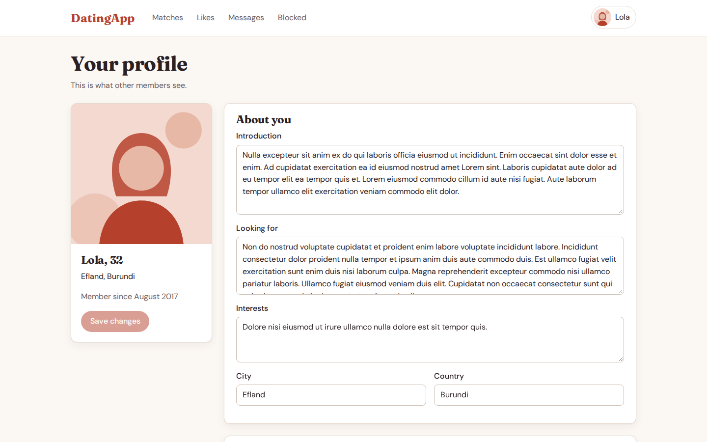
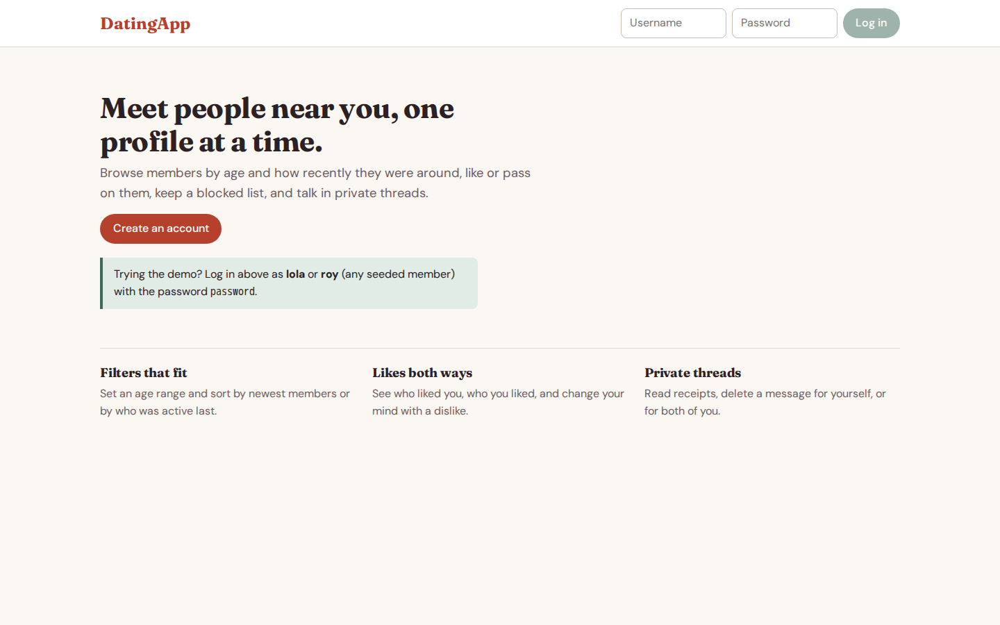
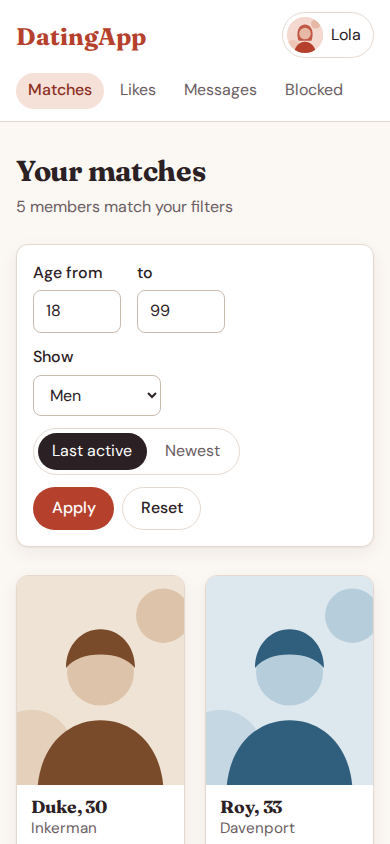
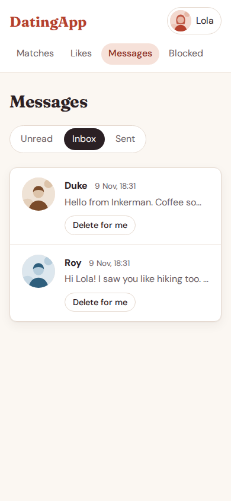
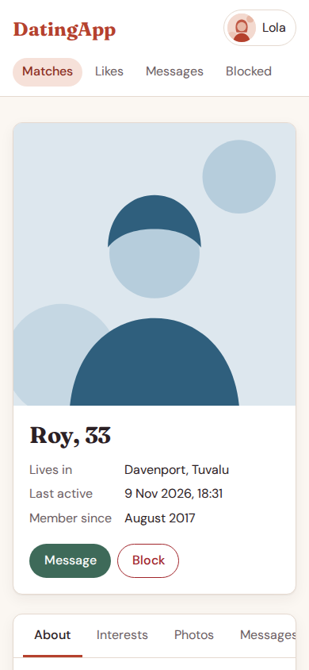
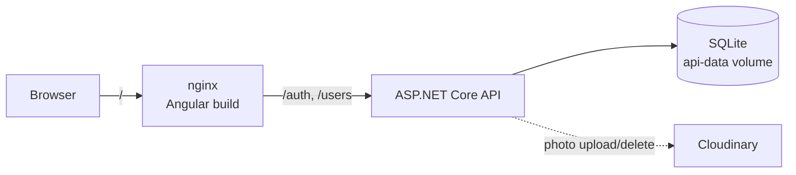

# DatingApp

A small dating site: members browse profiles filtered by age and activity,
like or pass on each other, block people, and talk in private threads. An
ASP.NET Core 10 Web API with Entity Framework Core and SQLite sits behind an
Angular 22 single-page app; Docker Compose runs both, with nginx serving the
SPA and proxying the API on the same origin.

This started as a course project (the classic ".NET API + Angular SPA" dating
app tutorial) and has since been extended and reworked: blocking and
dislikes, delete-for-everyone messages, a rebuilt UI, current framework
versions, and integration tests for the parts that were broken.



## What it does

- **Register and log in.** Passwords are 8 to 128 characters and stored as a
  salted HMAC-SHA512 hash; login returns a JWT that the SPA sends only to its
  own API.
- **Matches.** Members of the other gender by default, filtered by age range
  and sorted by last active or newest, eight to a page.
- **Likes and passes.** "Liked me", "I liked", "Passed on me" and "I passed
  on" lists. Passing on someone you liked replaces the like, and vice versa.
- **Blocking.** A block hides the two members from each other in both
  directions and stops messages between them. Blocked people are listed with
  an Unblock button.
- **Messages.** Per-member threads with read receipts, an Unread / Inbox /
  Sent view, delete for yourself, or (as the sender) delete for both.
- **Your profile.** Edit introduction, interests, what you are looking for
  and location; a warning appears before you leave with unsaved changes.
- **Photos.** Upload, pick a main photo, delete. Uploads are stored in
  Cloudinary, so they only work when Cloudinary credentials are supplied;
  without them the API answers `503` with an explanation and everything else
  keeps working.

| Conversation | Likes | Editing a profile |
| --- | --- | --- |
|  |  |  |

| Home | Matches (mobile) | Inbox (mobile) | Profile (mobile) |
| --- | --- | --- | --- |
|  |  |  |  |

The ten seed members are fictional, with lorem-ipsum bios and illustrated
placeholder avatars.

## Running it

You need Docker with Compose.

```bash
cd DatingApp
cp .env.example .env
# APP_TOKEN_KEY signs every JWT and must be at least 64 characters:
sed -i.bak "s|^APP_TOKEN_KEY=.*|APP_TOKEN_KEY=$(openssl rand -base64 48)|" .env && rm .env.bak
docker compose up --build
```

Open <http://localhost:4200> and log in as any seed member, for example
`lola` or `roy`, with the password `password`. The API is also published
directly on <http://localhost:5050>.

The database lives in the `api-data` volume and is created, migrated and
seeded on first start. `docker compose down -v` throws it away.

To enable photo uploads, fill in `CLOUDINARY_CLOUD_NAME`, `CLOUDINARY_API_KEY`
and `CLOUDINARY_API_SECRET` in `.env`.

### Without Docker

With the .NET 10 SDK and Node 22:

```bash
# API on http://localhost:5050
cd DatingApp/DatingApp.API
AppSettings__Token="$(openssl rand -base64 48)" dotnet run --urls http://localhost:5050

# SPA on http://localhost:4200, in a second terminal
cd DatingApp/DatingApp-SPA
npm ci
npm start
```

The development build calls the API at `http://localhost:5050/`
(`src/environments/environment.ts`); the API allows any origin.

## Tests and lint

```bash
cd DatingApp/DatingApp.API.Tests && dotnet test     # 29 xUnit integration tests
cd DatingApp/DatingApp-SPA && npm test             # 32 Vitest specs
cd DatingApp/DatingApp-SPA && npm run lint         # angular-eslint
```

The API tests start the real application in-process with
`WebApplicationFactory`, against a throwaway SQLite file that goes through
the real migrations. They cover registration and login, the signing-key
check, who may read or delete a message, the age, like and block filters,
idempotent seeding, account deletion and the missing-Cloudinary path.

## How it fits together



Requests from the browser never cross origins in the Compose setup: nginx
serves the built SPA and forwards `/auth/*` and `/users/*` to the API
container, so the production build uses a relative API URL and needs no CORS.

### API

All routes except `POST /auth/register` and `POST /auth/login` need a
`Bearer` token, and every route under `/users/{id}/...` that changes data
checks that `{id}` is the caller.

| Method and path | Purpose |
| --- | --- |
| `POST /auth/register`, `POST /auth/login` | create an account, get a token |
| `GET /users?pageNumber&pageSize&minAge&maxAge&gender&orderBy` | member list; add `likers`, `likees`, `dislikers`, `dislikees` or `blockees=true` for those lists |
| `GET /users/{id}`, `PUT /users/{id}`, `POST /users/{id}` | read, edit, delete an account |
| `POST /users/{id}/like/{other}`, `/dislike/{other}`, `/block/{other}`, `/unblock/{other}` | relationships |
| `GET /users/{id}/messages?messageContainer=Unread\|Inbox\|Outbox` | paged message folders |
| `GET /users/{id}/messages/thread/{other}`, `POST /users/{id}/messages` | a conversation; send |
| `POST /users/{id}/messages/{msg}`, `/{msg}/both`, `/{msg}/read` | delete for me, delete for both, mark read |
| `POST /users/{id}/photos`, `POST .../{photo}/set`, `DELETE .../{photo}` | photos |

Paged responses carry a `Pagination` header. Captured from the Compose stack:

```http
POST /auth/login
{"username":"lola","password":"password"}

200 OK
{"token":"eyJhbG…[REDACTED]","user":{"id":1,"username":"lola","gender":"female","age":32,
 "knownAs":"Lola","created":"2017-08-02T00:00:00","lastActive":"2026-11-09T18:31:40.3617013",
 "city":"Efland","country":"Burundi","photoUrl":"/avatars/lola.svg"}}
```

```http
GET /users?pageSize=2&orderBy=created
Authorization: Bearer …

200 OK
Pagination: {"currentPage":1,"itemsPerPage":2,"totalItems":5,"totalPages":3}
[{"id":8,"username":"lloyd","gender":"male","age":69,"knownAs":"Lloyd",…,"photoUrl":"/avatars/lloyd.svg"},
 {"id":6,"username":"roy","gender":"male","age":33,"knownAs":"Roy",…,"photoUrl":"/avatars/roy.svg"}]
```

```http
POST /auth/register
{"username":"sam","password":"short", …}

400 Bad Request
{"title":"One or more validation errors occurred.","status":400,
 "errors":{"Password":["Your password must be at least 8 characters"]}, …}
```

```http
POST /users/1/photos        (no Cloudinary credentials configured)

503 Service Unavailable
Photo uploads need Cloudinary credentials (CloudinarySettings__* environment variables).
```

## Design notes

- **Signing key.** `AppSettings:Token` must be at least 64 characters: the
  tokens are HS512, and IdentityModel refuses a shorter key. Startup fails
  with a sentence saying what to set rather than a stack trace from deep in
  the JWT handler. Compose refuses to start without `APP_TOKEN_KEY`.
- **Explicit mapping.** Entities are converted to DTOs by plain methods in
  `Helpers/DtoMappings.cs`. AutoMapper 10 crashed on .NET 7+ and carried a
  high-severity advisory; nine flat mappings did not need a mapper.
- **Filters in SQL.** Like, dislike and block filters are subqueries on the
  join tables, and queries with several collection includes run as split
  queries.
- **Seeding** runs on every start but only fills an empty database.
- **The SPA** uses standalone components, signals and zoneless change
  detection. Each page loads its own data and shows loading, empty and error
  states with a retry, instead of route resolvers that silently bounced you
  to another page on failure. There are no UI component libraries: a pager,
  avatar, toast and tab strip are each a few dozen lines.
- **Accessibility.** Every input has a label, the profile tabs follow the
  ARIA tabs pattern with arrow-key support, focus is always visible, a skip
  link leads to the content, and text meets WCAG AA contrast.

## Limitations

- Messages are fetched on page load; there is no live push.
- The JWT is kept in `localStorage`, as in the original design, so a script
  injected into the page could read it.
- Timestamps are the API server's local time without a zone.
- Photo storage needs a Cloudinary account; there is no local-disk fallback.
- SQLite suits a demo or a single small instance, not concurrent writers at
  scale.

## Layout

```
DatingApp/
  docker-compose.yml, .env.example, global.json
  DatingApp.API/          ASP.NET Core 10 Web API
    Controllers/          Auth, Users, Messages, Photos
    Data/                 DbContext, repositories, seed data, DatabaseSetup
    Dtos/  Models/  Helpers/  Migrations/
  DatingApp.API.Tests/    xUnit v3 integration tests
  DatingApp-SPA/          Angular 22
    src/app/_services/    API clients, auth, toasts, error text
    src/app/_shared/      pager, avatar, toast outlet
    src/app/members/      matches, profile, editing, photos, messages
    public/avatars/       illustrated seed avatars
docs/screenshots/         the images above
```

## License

MIT; see [LICENSE](LICENSE).
